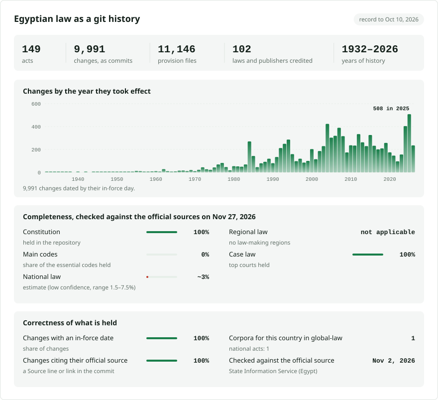

# Egypt: law history in git

[العربية](README.md) · **English**

<picture>
<source media="(prefers-color-scheme: dark)" srcset="data/effort-dark.svg">

</picture>

The law of Egypt as a git history: one file per article, one commit per version on the day it took effect, and the law that made each change as the commit's author. `git blame` names the law behind every article; `git log` lists every change to an article; picking a date gives the text in force that day.

Part of [lexifina/global-law](https://github.com/lexifina/global-law), one git history for every country's law: this is Egypt's national law, which global-law reads at `egypt/national/acts/`.

**What is in it now:** the Constitution of 2014 as amended in April 2019, in one version, twice: the official Arabic text (the Preamble and 257 articles, three of them "bis") and the State Information Service's English translation (the Preamble and 254 articles). No statute is here yet. [`REPRODUCE.md`](REPRODUCE.md) lists both texts with their versions and says how the files were made; each folder has a README listing its articles.

Each text is a folder, one file per article: `dustur/art-001.md` is Article 1 of the Arabic text, `dustur/art-150-bis.md` is Article 150 bis, and `constitution/art-001.md` is Article 1 in English.

The Arabic text (`dustur/`) is the authoritative one, as the State Information Service prints it; `constitution/` is its English translation, not an official text of the law.

## Questions as git commands

| Question | Command |
| --- | --- |
| Every change to Article 1 of the Constitution | `git log -p --word-diff -- dustur/art-001.md` |
| Which law wrote each line of Article 1? | `git blame dustur/art-001.md` |
| Every version of the Constitution, with the day each took effect | `git log --format="%h %(trailers:key=In-force,valueonly,separator=) %an" -- "dustur/art-*"` |
| Article 1 as in force on 1 January 2024 | `python tools/on.py 2024-01-01 dustur art-001` |

For the English translation, put `constitution` in place of `dustur`.

**Outside git**, we also host this record publicly, for free:

- **[Ask Claude about Egyptian law](https://global-law.lexifina.com/v1/try_claude?country=egypt)**: opens Claude with a first question ready.
- **[Ask ChatGPT](https://global-law.lexifina.com/v1/try_chatgpt?country=egypt)**: the same question in ChatGPT.
- **[Search Egyptian law on our site](https://lexifina.com/law?country=egypt&q=%D8%A7%D9%84%D8%A5%D8%B6%D8%B1%D8%A7%D8%A8)**: a search for "الإضراب" (the strike), with each provision's text and its versions, no account needed.
- **[Developer REST API](https://global-law.lexifina.com/v1/search_law?query=%D8%A7%D9%84%D8%A5%D8%B6%D8%B1%D8%A7%D8%A8&jurisdiction=egypt)**: the same search as JSON, with no key. See the [documentation here](https://lexifina.com/api/global-law).

Both assistants read the record through the free Global law connector (MCP, `https://global-law.lexifina.com/mcp`); the first time, the chat gives you the link that adds it. Ask in Arabic or in English.

**Host it yourself easily.** All it takes is git and Python, and the tools run on your machine:

```sh
git clone --depth 1 https://github.com/lexifina/global-law && cd global-law
python3 tools/countries.py add egypt/national/acts
python3 tools/law.py show 2026-01-01 egypt/national/acts/dustur/art-001.md
```

Opened in Claude Code, Cursor, VS Code or Codex, the clone also starts a local MCP server with the same tools ([MCP.md](https://github.com/lexifina/global-law/blob/main/MCP.md)).

## Dates

Each commit is dated at noon, Africa/Cairo, on the day the version took effect, and carries it in its `In-force:` trailer:

- both texts are the consolidated Constitution with the amendments approved by the referendum of 20-22 April 2019, and the source gives no earlier version, so each is dated 23 April 2019, the day the amendments took effect;
- that day follows article 226: an amendment takes effect on the day the referendum result is announced, here 23 April 2019.

Each text is the oldest version available and is credited to the publisher, `State Information Service (Egypt)` (`Kind: publisher`), not to a law. The committer is Lexifina.

## How it is checked

- `tools/check_repo.py` reads every version back from git on the day it took effect and on the day before and compares it with the corpus, whose hash is in `data/corpus.sha256`; it also checks that every commit's trailers parse, that `main` has no merge commits and that no commit is dated in the future. [`REPRODUCE.md`](REPRODUCE.md) does not record a result for this build yet.
- `tools/build.py` writes the history from that one corpus file, and the same corpus gives the same commit hashes; no second build has been compared yet.
- The wording is not corrected: the translation's own typing errors are kept as printed; only spacing, quotes, dashes and the Arabic tatweel (letter stretching) are normalised.
- History is append-only: the Arabic text was added as a new commit after the first build, not written into it.

## What it does not show

- **Earlier versions.** The Constitution as adopted (in force from 18 January 2014) and the 2019 amendments are not shown as separate versions: the State Information Service publishes only the consolidated text. The Arabic page's footnotes, left out here, name the articles substituted or added in 2019.
- **Statutes.** No Egyptian law other than the Constitution is here yet; the official gazette and the official consolidated legislation databases (the Court of Cassation's and the Cabinet's) give the full text only to subscribers.
- **Articles 150 bis, 241 bis and 244 bis as their own files in English:** the translation prints them at the end of articles 150, 241 and 244.
- **Headings and apparatus.** Part, Chapter and Section headings, the table of contents, page numbers and footnotes are left out; the English paragraph breaks are rebuilt from the PDF's line layout.

## Sources

| Source | Kind | Past versions | Notes |
| --- | --- | --- | --- |
| [State Information Service](https://sis.gov.eg/ar/%D9%85%D8%B5%D8%B1/%D8%A7%D9%84%D8%AF%D8%B3%D8%AA%D9%88%D8%B1-%D8%A7%D9%84%D9%85%D8%B5%D8%B1%D9%89/) | The Constitution, official Arabic text (web page) | no, one consolidated text | The authoritative text; read on 2 November 2026 |
| [State Information Service](https://sis.gov.eg/media/67726/dustor-eng.pdf) | The Constitution, English translation (PDF) | no, one consolidated text | A translation; read on 29 October 2026 |

## Licence

See [`LICENSE`](LICENSE). Official documents, whatever their language or the language they are translated into, including the texts of laws, are excluded from copyright by article 141 of Law No. 82 of 2002 on the Protection of Intellectual Property Rights. Lexifina's own contributions (the history, commit messages, tables and tools) are CC0 1.0.

No AI model wrote, translated or corrected legal text; the scripts were written by an AI model, and no model runs when the history is built (see [`REPRODUCE.md`](REPRODUCE.md)).

## More

From [lexifina/global-law](https://github.com/lexifina/global-law):

- [FEATURES.md](https://github.com/lexifina/global-law/blob/main/FEATURES.md): every feature, and what every corpus must support (`git blame`, `law.py`, the MCP tools)
- [FAQ.md](https://github.com/lexifina/global-law/blob/main/FAQ.md): questions and answers · [CONTRIBUTING.md](https://github.com/lexifina/global-law/blob/main/CONTRIBUTING.md): proposing changes · [MCP.md](https://github.com/lexifina/global-law/blob/main/MCP.md): the MCP server · [REPRODUCE.md](https://github.com/lexifina/global-law/blob/main/REPRODUCE.md): how it was built · [CHANGELOG.md](https://github.com/lexifina/global-law/blob/main/CHANGELOG.md)
- [FRESHNESS.md](https://github.com/lexifina/global-law/blob/main/FRESHNESS.md): how current each corpus is · [Monitoring](https://github.com/lexifina/global-law/tree/main/monitoring): whether updates are running · [WATCHING.md](https://github.com/lexifina/global-law/blob/main/WATCHING.md): how each official source is watched for changes
- [performance/](https://github.com/lexifina/global-law/tree/main/performance): how fast the tools are, measured
- [visualisations/](https://github.com/lexifina/global-law/tree/main/visualisations): charts and bridges across the world's law
- [Vulnerabilities](https://github.com/lexifina/global-law/tree/main/vulnerabilities): mistakes in legislation as published
