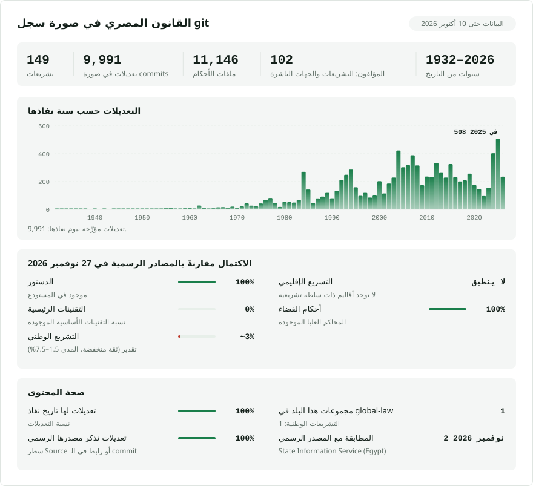

# مصر: تاريخ القانون في git

**العربية** · [English](README.en.md)

<picture>
<source media="(prefers-color-scheme: dark)" srcset="data/ar/effort-dark.svg">

</picture>

القانون المصري في صورة سجل git: ملف لكل مادة، ولكل نسخة commit واحد في يوم نفاذها، والقانون الذي أجرى كل تعديل هو مؤلف الـ commit. يبيّن `git blame` القانون الذي يقف وراء كل مادة؛ ويسرد `git log` كل تعديل طرأ على مادة؛ واختيار تاريخ ما يعطي النص النافذ في ذلك اليوم.

جزء من [lexifina/global-law](https://github.com/lexifina/global-law)، وهو سجل git واحد لقانون كل بلد: هذا هو القانون الوطني المصري، الذي يقرؤه global-law في `egypt/national/acts/`.

**المحتوى الحالي:** دستور 2014 بصيغته المعدَّلة في أبريل 2019، في نسخة واحدة، مرتين: النص العربي الرسمي (الديباجة و257 مادة، ثلاث منها "مكررًا") والترجمة الإنجليزية الصادرة عن الهيئة العامة للاستعلامات (الديباجة و254 مادة). ولا يوجد هنا أي قانون حتى الآن. يسرد [`REPRODUCE.md`](REPRODUCE.md) النصين مع نسخهما ويبيّن كيف أُعدّت الملفات؛ وفي كل مجلد ملف README يسرد مواده.

كل نص مجلد، فيه ملف لكل مادة: `dustur/art-001.md` هي المادة 1 من النص العربي، و`dustur/art-150-bis.md` هي المادة 150 مكررًا، و`constitution/art-001.md` هي المادة 1 بالإنجليزية.

النص العربي (`dustur/`) هو النص المعتمد، كما تنشره الهيئة العامة للاستعلامات؛ أما `constitution/` فهو ترجمته الإنجليزية، وليس نصًا رسميًا للقانون.

## الأسئلة في صورة أوامر git

| السؤال | الأمر |
| --- | --- |
| كل تعديل طرأ على المادة 1 من الدستور | `git log -p --word-diff -- dustur/art-001.md` |
| أي قانون كتب كل سطر من المادة 1؟ | `git blame dustur/art-001.md` |
| كل نسخ الدستور، مع يوم نفاذ كل منها | `git log --format="%h %(trailers:key=In-force,valueonly,separator=) %an" -- "dustur/art-*"` |
| المادة 1 كما كانت نافذة في 1 يناير 2024 | `python tools/on.py 2024-01-01 dustur art-001` |

للترجمة الإنجليزية، ضع `constitution` مكان `dustur`.

**خارج git**، نستضيف هذا السجل أيضًا للعموم، مجانًا:

- **[اسأل Claude عن القانون المصري](https://global-law.lexifina.com/v1/try_claude?country=egypt)**: يفتح Claude ومعه سؤال أول جاهز.
- **[اسأل ChatGPT](https://global-law.lexifina.com/v1/try_chatgpt?country=egypt)**: السؤال نفسه في ChatGPT.
- **[ابحث في القانون المصري على موقعنا](https://lexifina.com/law?country=egypt&q=%D8%A7%D9%84%D8%A5%D8%B6%D8%B1%D8%A7%D8%A8)**: بحث عن "الإضراب"، مع نص كل حكم ونسخه، دون الحاجة إلى حساب.
- **[واجهة REST API للمطوّرين](https://global-law.lexifina.com/v1/search_law?query=%D8%A7%D9%84%D8%A5%D8%B6%D8%B1%D8%A7%D8%A8&jurisdiction=egypt)**: البحث نفسه بصيغة JSON، دون مفتاح. انظر [التوثيق هنا](https://lexifina.com/api/global-law).

يقرأ المساعدان كلاهما السجل عبر موصِّل Global law المجاني (MCP، `https://global-law.lexifina.com/mcp`)؛ وفي المرة الأولى تعطيك المحادثة الرابط الذي يضيفه. اسأل بالعربية أو بالإنجليزية.

**استضفه بنفسك بسهولة.** كل ما يلزم هو git وPython، والأدوات تعمل على جهازك:

```sh
git clone --depth 1 https://github.com/lexifina/global-law && cd global-law
python3 tools/countries.py add egypt/national/acts
python3 tools/law.py show 2026-01-01 egypt/national/acts/dustur/art-001.md
```

عند فتح النسخة المستنسخة في Claude Code أو Cursor أو VS Code أو Codex، تشغّل أيضًا خادم MCP محليًا بالأدوات نفسها ([MCP.md](https://github.com/lexifina/global-law/blob/main/MCP.md)).

## التواريخ

يحمل كل commit تاريخ الظهيرة، بتوقيت Africa/Cairo، من اليوم الذي نفذت فيه النسخة، ويحمل هذا اليوم في تذييله (trailer) `In-force:`:

- النصان كلاهما هما الدستور بصيغته الموحَّدة مع التعديلات التي أقرّها استفتاء 20-22 أبريل 2019، ولا يعطي المصدر أي نسخة سابقة، لذا يحمل كل منهما تاريخ 23 أبريل 2019، وهو يوم نفاذ التعديلات؛
- يتبع هذا اليوم المادة 226: يُعمل بالتعديل من تاريخ إعلان نتيجة الاستفتاء، وهو هنا 23 أبريل 2019.

كل نص هو أقدم نسخة متاحة، ويُنسب إلى الجهة الناشرة، `State Information Service (Egypt)` (`Kind: publisher`)، لا إلى قانون. والمُودِع (committer) هو Lexifina.

## كيف يُتحقَّق منه

- يعيد `tools/check_repo.py` قراءة كل نسخة من git في يوم نفاذها وفي اليوم السابق له، ويقارنها بالمجموعة، التي توجد بصمتها (hash) في `data/corpus.sha256`؛ ويتحقق أيضًا من أن تذييلات كل commit قابلة للتحليل، وأن `main` خالٍ من commits الدمج، وأنه لا يوجد commit مؤرَّخ في المستقبل. لا يسجّل [`REPRODUCE.md`](REPRODUCE.md) نتيجة لهذا البناء حتى الآن.
- يكتب `tools/build.py` السجل من ملف المجموعة الواحد هذا، والمجموعة نفسها تعطي بصمات الـ commits نفسها؛ ولم تُقارَن به أي عملية بناء ثانية حتى الآن.
- لا تُصحَّح الصياغة: تُبقى أخطاء الطباعة الواردة في الترجمة نفسها كما طُبعت؛ ولا يوحَّد سوى المسافات وعلامات الاقتباس والشَّرطات والتطويل العربي (مدّ الحروف).
- السجل لا يقبل إلا الإضافة: أُضيف النص العربي في commit جديد بعد البناء الأول، ولم يُكتب داخله.

## ما لا يُظهره

- **النسخ السابقة.** لا يُعرض الدستور كما صدر (النافذ اعتبارًا من 18 يناير 2014) ولا تعديلات 2019 بوصفها نسخًا مستقلة: فالهيئة العامة للاستعلامات لا تنشر سوى النص الموحَّد. وحواشي الصفحة العربية، المستبعدة هنا، تسمّي المواد التي استُبدلت أو أُضيفت في 2019.
- **القوانين.** لا يوجد هنا أي قانون مصري غير الدستور حتى الآن؛ فالجريدة الرسمية وقواعد بيانات التشريعات الموحَّدة الرسمية (قاعدة محكمة النقض وقاعدة مجلس الوزراء) لا تتيح النص الكامل إلا للمشتركين.
- **المواد 150 مكررًا و241 مكررًا و244 مكررًا في ملفات مستقلة بالإنجليزية:** فالترجمة تطبعها في نهاية المواد 150 و241 و244.
- **العناوين والملحقات.** تُستبعد عناوين الأبواب والفصول والفروع، وفهرس المحتويات، وأرقام الصفحات، والحواشي؛ ويُعاد بناء فواصل الفقرات الإنجليزية من تخطيط أسطر ملف PDF.

## المصادر

| المصدر | النوع | النسخ السابقة | ملاحظات |
| --- | --- | --- | --- |
| [الهيئة العامة للاستعلامات](https://sis.gov.eg/ar/%D9%85%D8%B5%D8%B1/%D8%A7%D9%84%D8%AF%D8%B3%D8%AA%D9%88%D8%B1-%D8%A7%D9%84%D9%85%D8%B5%D8%B1%D9%89/) | الدستور، النص العربي الرسمي (صفحة ويب) | لا، نص موحَّد واحد | النص المعتمد؛ قُرئ في 2 نوفمبر 2026 |
| [الهيئة العامة للاستعلامات](https://sis.gov.eg/media/67726/dustor-eng.pdf) | الدستور، الترجمة الإنجليزية (PDF) | لا، نص موحَّد واحد | ترجمة؛ قُرئت في 29 أكتوبر 2026 |

## الترخيص

انظر [`LICENSE`](LICENSE). تُستثنى من حماية حق المؤلف، بموجب المادة 141 من قانون حماية حقوق الملكية الفكرية رقم 82 لسنة 2002، الوثائقُ الرسمية أيًّا كانت لغتها الأصلية أو اللغة المنقولة إليها، ومنها نصوص القوانين. أما إسهامات Lexifina الخاصة (السجل، ورسائل الـ commits، والجداول، والأدوات) فهي متاحة بموجب CC0 1.0.

لم يكتب أي نموذج ذكاء اصطناعي نصًا قانونيًا ولم يترجمه ولم يصححه؛ أما البرامج النصية (scripts) فكتبها نموذج ذكاء اصطناعي، ولا يعمل أي نموذج عند بناء السجل (انظر [`REPRODUCE.md`](REPRODUCE.md)).

هذا النص ترجمة للنسخة الإنجليزية ([README.en.md](README.en.md))؛ وعند الاختلاف تسود النسخة الإنجليزية.

## المزيد

من مستودع [lexifina/global-law](https://github.com/lexifina/global-law) (صفحات باللغة الإنجليزية):

- [FEATURES.md](https://github.com/lexifina/global-law/blob/main/FEATURES.md): جميع الميزات، وما يجب أن تدعمه كل مجموعة (`git blame`، `law.py`، أدوات MCP)
- [FAQ.md](https://github.com/lexifina/global-law/blob/main/FAQ.md): أسئلة وأجوبة · [CONTRIBUTING.md](https://github.com/lexifina/global-law/blob/main/CONTRIBUTING.md): اقتراح تغييرات · [MCP.md](https://github.com/lexifina/global-law/blob/main/MCP.md): خادم MCP · [REPRODUCE.md](https://github.com/lexifina/global-law/blob/main/REPRODUCE.md): طريقة البناء · [CHANGELOG.md](https://github.com/lexifina/global-law/blob/main/CHANGELOG.md)
- [FRESHNESS.md](https://github.com/lexifina/global-law/blob/main/FRESHNESS.md): مدى حداثة كل مجموعة · [المراقبة](https://github.com/lexifina/global-law/tree/main/monitoring): هل تعمل التحديثات · [WATCHING.md](https://github.com/lexifina/global-law/blob/main/WATCHING.md): كيف يُراقَب كل مصدر رسمي لرصد التغييرات
- [performance/](https://github.com/lexifina/global-law/tree/main/performance): سرعة الأدوات كما قيست
- [visualisations/](https://github.com/lexifina/global-law/tree/main/visualisations): رسوم بيانية وروابط عبر قوانين العالم
- [الثغرات](https://github.com/lexifina/global-law/tree/main/vulnerabilities): أخطاء في التشريعات كما نُشرت
